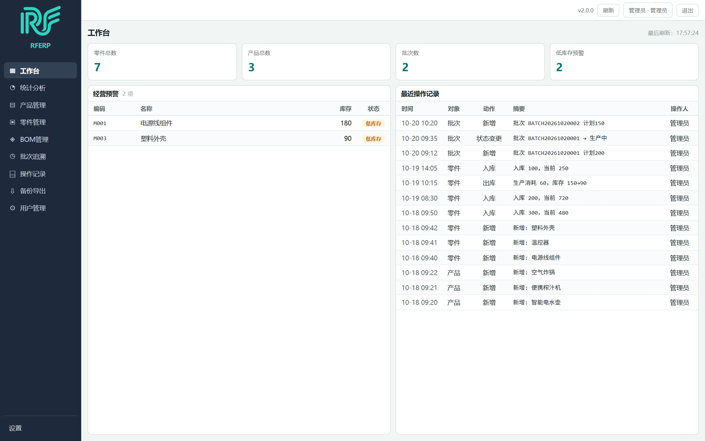

# RFERP
# 仁风仓库管理系统

[English](README.md) | **中文**

---

面向小微生产的**进销存与批次追溯**桌面应用，覆盖产品、零件、BOM、生产批次、库存、操作记录与数据备份导出。

使用 **Wails v2**（Go 后端）与 **React + TypeScript** 前端构建，数据存储于 **MySQL 8** 或本机 **SQLite** 文件，支持一键安装与自动更新。

## 界面预览



## 功能特性

- **用户与权限**：账号登录、四种角色（管理员 / 仓管 / 生产 / 只读）、按角色控制功能可见性、操作人留痕
- **产品 / 零件管理**：编码、规格、单位、状态、库存预警
- **BOM 管理**：产品与零件的用量关系、损耗率、可替换与用量模式
- **生产批次**：计划 / 已产数量、批次状态流转、投料记录
- **批次追溯**：按产品批次或零件追溯用料来源
- **库存管理**：入库、出库、盘点、预警列表
- **操作记录**：结构化展示（类型 / 操作 / 对象 / 变更明细），可查看详情
- **备份导出**：整库备份与恢复（MySQL 用 SQL 备份、SQLite 用整库快照）与各表导出（CSV），数据目录可自选

## 下载安装

1. 打开 [最新版本](https://github.com/LzYita/RFERP/releases/latest)
2. 下载 `Setup-RFERP-x.y.z.exe`
3. 双击安装（中文界面，可自选安装路径）

> 系统要求：**Windows 10 / 11（64 位）**，以及 **Microsoft Edge WebView2 运行时**。
> Windows 11 与带 Edge 的 Windows 10 已预装；若缺失，程序会在首次启动时自动下载安装
> （装好后继续启动，不用重启），失败则给出手动下载页。

部署与运维说明（单实例、重启即登出、跨机走 VPN、更新与回退行为）见
[docs/deployment.md](docs/deployment.md)。

## 存储方式

| 存储 | 适用场景 |
|---|---|
| **MySQL**（默认） | 多人 / 多机共用一份数据，需要本机安装 MySQL 8。 |
| **SQLite** | 单机使用、无需额外安装。整个数据库就是一个文件：`<数据目录>\rferp.db`。 |

- **首次运行向导**会提供两种选择；也可在 `config.json` 里设置 `"storage": "sqlite"`。
- 配置中没有 `storage` 字段时**一律按 MySQL 处理**，程序不会静默切换。
- **切换存储只改配置，不会迁移数据**；请自行从旧存储导出、再导入到新存储。
- 备份恢复随存储类型走，两种后端不混用也不合并数据。MySQL 在单个事务内以 `.sql` 备份覆盖业务表，账号、迁移记录与数据库身份保留现场状态。SQLite 用 `.db` 快照替换整个数据库文件，**包括**这些系统记录和表结构，然后重启应用。两者恢复前都会生成可在备份界面选择的 `pre_restore_` 副本，供回退使用。

## 首次运行

**① 选择存储方式** —— MySQL 或 SQLite（见上方「存储方式」）

**② 数据库配置向导（仅 MySQL）**

1. 自动检测本机 MySQL（服务名、端口、`mysqldump` 路径）
2. 填写连接信息（主机、端口、用户名、密码、数据库名）与**数据目录**
3. 点击「初始化并启动」：
   - 自动创建数据库与数据表
   - 使用 root 连接时，自动创建专用最小权限账号
   - 连接信息以 **Windows DPAPI 加密**后保存在本机

**③ 创建管理员账号**

数据库就绪后，若系统还没有任何账号，会引导创建**管理员**（用户名 + 密码）。
之后每次启动进入**登录窗**，可勾选「记住登录」下次自动进入。

> 若本机尚未安装 MySQL，向导提供官方安装器下载入口。

## 用户与权限

| 角色 | 说明 |
|---|---|
| 管理员 | 全部功能，含用户管理与备份恢复 |
| 仓管 | 零件/库存可写，其余只读 |
| 生产 | 批次追溯可写，其余只读 |
| 只读 | 仅查看与导出 |

- 无权限的功能**不会显示**（而非置灰）；
- 所有新增/修改/删除/出入库等操作**自动记录操作人**；
- 账号存于数据库，**多机共享**；至少保留一个启用的管理员。

## 自动更新

- 程序启动后会自动检查新版本
- 更新包与更新清单使用 **Ed25519 签名**校验，签名不符则拒绝更新
- 发现新版本时弹窗提示，可选择立即更新

## 从源码构建

> 构建、签名与发布脚本**不属于本仓库**，也不随本仓库公开 ——
> 流程与原因见 [CONTRIBUTING 的发版流程](CONTRIBUTING.md#发版流程)。下面只讲如何构建应用本身。

### 需要什么

| 项 | 要求 |
|---|---|
| 操作系统 | Windows 10 / 11（64 位） |
| Go | **1.26 或更新**（发布与 CI 使用 **go1.26.5** 构建） |
| C 编译器 | **64 位 mingw-w64 GCC**（CGO 需要）。**已验证：TDM-GCC 64 位（10.3.0）**；其他 GCC 发行版可能无法产出可运行的二进制 |
| Node.js | 20 或更新，用于构建编入二进制的前端包 |
| Wails CLI | `go install github.com/wailsapp/wails/v2/cmd/wails@v2.16.0` |
| Inno Setup | 6（仅在打安装包时需要） |

> 这些工具**只有构建者需要**；**最终用户既不需要 Go、GCC，也不需要 Node**（发布物自带运行时）。
> 但最终用户需要 **WebView2 运行时** —— 缺失时程序会在首次启动时引导安装。

### 构建应用

这是 Wails 应用：前端包在编译期嵌入，所以必须先构建前端。

```bat
cd web && npm ci && npm run build:embed && cd ..
cd cmd\desktop-wails && wails build -s
```

产物：`cmd\desktop-wails\build\bin\RFERP.exe`

> 用 `npm ci` 而不是 `npm install`：发布必须按锁定版本构建，CI 也是这么做的。
## 技术栈

| 层 | 技术 |
|---|---|
| 语言 | Go 1.26 |
| 桌面外壳 | Wails v2.16（Microsoft Edge WebView2） |
| 前端 | React 19、TypeScript 6、Vite 8 |
| 数据库 | MySQL 8.0，或内嵌 SQLite（`modernc.org/sqlite`，纯 Go、无 CGO） |
| 密码哈希 | PBKDF2-SHA256 |
| 凭据保护 | Windows DPAPI |
| 更新签名 | Ed25519 |
| 安装包 | Inno Setup 6 |

## 目录结构

```
cmd/
  desktop-wails/ Wails 程序入口（窗口与无头 -serve 两种形态）
  keygen/        生成更新签名密钥对
  signmanifest/  生成并签名更新清单
internal/
  auth/          用户、角色、权限、密码哈希、记住登录
  config/        配置加载与加密保存
  dbfile/        本地数据库文件识别（SQLite 魔数）
  secret/        DPAPI 加解密
  repository/    数据访问
  service/       业务逻辑
  migrate/       版本化数据库迁移
  update/        自动更新、未确认标记与回退
  winappid/      Windows 任务栏 AppUserModelID
  nativefiledialog/  原生文件夹选择器
  ...
web/             React + TypeScript 前端，构建时嵌入
docs/decisions/  决策记录（D-xxx）
docs/plans/      迁移计划与进度
docs/deployment.md  部署与运维说明
```

## 许可证

**保留所有权利。** 本仓库仅供查阅源码与反馈问题，**未授权任何复用**。

你可以阅读源码、提交 issue，但**不得**在未经作者书面许可的情况下复制、修改、再分发
或进行商业利用 —— 包括基于本代码开发竞品。

第三方依赖保留其各自的宽松许可证（BSD-3-Clause / MIT / MPL-2.0），
详见 `go.mod`；该声明不影响这些依赖的授权条款。

本声明可能变更。截至目前未曾授予任何许可证；未来若添加许可证，
亦无法追回已获取旧版本副本者已获得的权限。

---

[↑ 返回顶部](#rferp)
